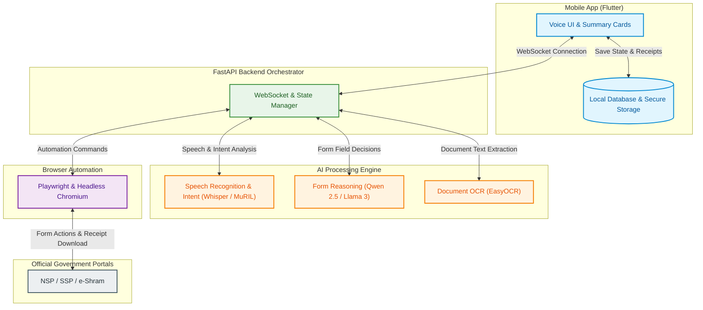
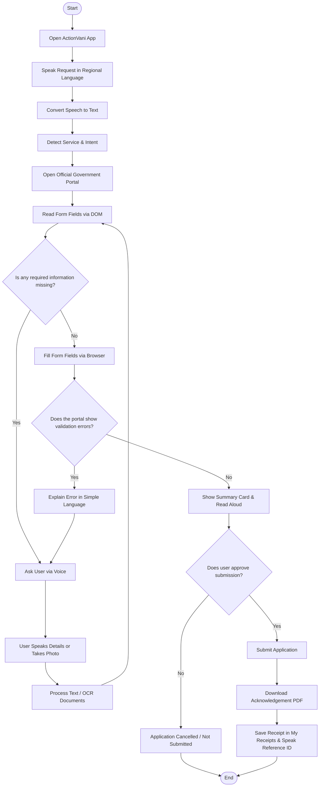

# ActionVani (IndicAgent)

> **Voice-Driven Agentic Execution Engine for Digital India Public Services**  
> *Helping citizens complete government portal applications through natural voice conversations in their regional languages.*

---

## Table of Contents

- [1. Project Overview](#1-project-overview)
- [2. Problem Statement](#2-problem-statement)
- [3. Proposed Solution](#3-proposed-solution)
- [4. Methodology / Working Method](#4-methodology--working-method)
- [5. Key Features](#5-key-features)
- [6. System Architecture](#6-system-architecture)
- [7. User Flow Diagram](#7-user-flow-diagram)
- [8. Security and Privacy](#8-security-and-privacy)
- [9. Limitations](#9-limitations)
- [10. Future Scope](#10-future-scope)
- [11. Repository Structure](#11-repository-structure)

---

## 1. Project Overview

ActionVani (IndicAgent) is a voice-first, AI-powered mobile application designed to help Indian citizens apply for government services and welfare schemes. 

Instead of forcing users to struggle with complicated websites, ActionVani lets citizens speak naturally in their own regional languages. The app listens to the user's request, opens the official government portal in a background browser, understands the application form, collects missing details through simple conversation, and fills out the form automatically. 

After the user reviews and confirms the details, ActionVani submits the application and saves the official acknowledgement receipt directly on their phone.

---

## 2. Problem Statement

India has built world-class digital systems like UPI and DigiLocker, but accessing public welfare portals remains difficult for ordinary citizens:

- **Complicated Forms:** Portals like the National Scholarship Portal (NSP), State Scholarship Portal (SSP), and e-Shram have confusing multi-step forms with many dropdowns and technical inputs.
- **English-Centric Interfaces:** Most portal instructions and error messages are written in technical English, making them hard to understand for regional-language speakers.
- **Digital Literacy Barriers:** Citizens who are not comfortable with computers struggle with strict document formats, file size limits, and navigation.
- **Cyber Cafe Exploitation:** Many citizens are forced to visit unaccredited cyber cafes, paying ₹100 to ₹300 per form just to get basic applications submitted.
- **Privacy and Security Risks:** Sharing Aadhaar cards, bank details, and passwords with cyber cafe operators exposes citizens to data theft and misuse.

---

## 3. Proposed Solution

ActionVani bridges this gap by turning complex web forms into a simple voice conversation. 

The user taps a button and speaks in their regional language (such as Hindi, Kannada, or Tamil). ActionVani understands the request, opens the official government portal using a background browser, and inspects the form fields. If any information is missing, the AI asks the user for it one question at a time. It also helps scan documents using the phone camera to extract details automatically.

### How ActionVani Differs from Normal Chatbots

Most government chatbots only provide information, scheme rules, and website links. They tell you *where* to go, but you still have to fill out the form yourself. 

ActionVani is an **agentic execution engine**: it does not just provide links—it actually interacts with the portal and fills out the application for you under your supervision.

---

## 4. Methodology / Working Method

ActionVani completes applications through an 11-step process:

1. **Voice Input:** The citizen taps the microphone and speaks their request in their regional language.
2. **Speech Recognition:** The system converts the spoken audio into text.
3. **Intent Recognition:** The AI identifies which government service or scheme the user wants.
4. **Portal Navigation:** The backend launches an automated background browser and visits the official portal.
5. **DOM Extraction:** The browser reads the webpage structure and identifies all required form fields.
6. **Conversational Data Collection:** The AI asks the user for missing details one question at a time.
7. **Document Processing:** The phone camera and OCR extract names and numbers from physical documents.
8. **Form Filling:** The browser automatically enters the information into the correct portal fields.
9. **Error Handling:** If the portal shows a validation error, the AI translates it into simple language and asks for a correction.
10. **User Confirmation:** The app displays and reads aloud a summary of all entered details for the user's approval.
11. **Submission and Receipt:** Once confirmed, the browser submits the form, downloads the official acknowledgement PDF, and saves it on the phone.

---

## 5. Key Features

- **Regional-Language Voice Interaction:** Speak and listen in your native Indian language.
- **AI-Based Intent Recognition:** Automatically identifies which government scheme you need.
- **Background Browser Automation:** Navigates live portals without requiring manual web browsing.
- **Dynamic Webpage Reading:** Understands form inputs using webpage accessibility trees and HTML labels.
- **Conversational Form Filling:** Collects missing information step-by-step instead of showing long forms.
- **OCR Document Extraction:** Scans physical identity cards and certificates to extract details automatically.
- **Secure Password Handling:** Passwords are typed securely on-screen and are never spoken aloud.
- **OTP and CAPTCHA Assistance:** Prompts the user to solve visual CAPTCHAs or enter OTPs directly.
- **Summary and Review Cards:** Shows clear, high-contrast review cards before submitting.
- **Application Status Tracking:** Uses saved reference numbers to check application status on official portals.
- **Offline Session Persistence:** Saves your progress locally so you can resume if your connection drops.
- **My Receipts Manager:** Stores downloaded PDF acknowledgement receipts locally for offline viewing and sharing.

---

## 6. System Architecture

ActionVani consists of four core components working together in real time:

- **Mobile Application (Flutter & Dart):** A simple Android app with a Material 3 interface, single-tap voice recording, visual review cards, secure credential storage, and an offline SQLite database.
- **Backend Server (Python & FastAPI):** A fast orchestration server that manages real-time WebSocket communication between the phone, the AI models, and the browser.
- **AI Processing Engine:** Handles speech-to-text (Whisper / Indic speech APIs), intent classification (MuRIL / IndicBERT), form reasoning (Qwen 2.5 / Llama 3), and document OCR (EasyOCR / PaddleOCR).
- **Browser Automation (Playwright & Chromium):** A headless browser that visits official government websites, reads form fields, and types in user data.

### Architecture Diagram



---

## 7. User Flow Diagram

The diagram below shows how a user interacts with ActionVani, including handling missing details, errors, and final approval:



---

## 8. Security and Privacy

ActionVani is designed with careful safeguards to protect user privacy:

- **Zero-Vocal Passwords:** Users never speak passwords aloud. Passwords and PINs are entered only through a masked screen keypad.
- **On-Device Storage:** Sensitive credentials and receipts are stored on the phone using encrypted device storage and Android Keystore.
- **Isolated Browser Sessions:** Each application runs in a clean, separate browser session that is cleared after the task finishes.
- **Approved Domains Only:** The browser is strictly restricted to official government websites (`.gov.in` and `.nic.in`).
- **Untrusted Web Content:** Webpage text is cleaned and sanitized to prevent hidden website code from manipulating the AI.
- **Mandatory User Confirmation:** The system will never submit a form without explicit user approval.
- **No Unnecessary Logging:** Sensitive personal information like full Aadhaar numbers and passwords are never stored on central servers or written to log files.

---

## 9. Limitations

While ActionVani aims to make public services accessible, there are real-world technical limitations to consider:

- **Frequent Portal Changes:** Government websites sometimes update their HTML layout or button names, which can temporarily disrupt automated field mapping.
- **Anti-Automation Protections:** Some government portals actively block automated browsers or use strict rate-limiting.
- **Complex CAPTCHAs & OTPs:** Visual image CAPTCHAs and SMS OTPs cannot be completed entirely automatically and require the user's manual help.
- **Speech Recognition Challenges:** Noisy environments, heavy accents, and uncommon local dialects can lead to speech recognition errors.
- **Document Quality in OCR:** Low-quality photos, folded papers, or handwritten text can cause errors during OCR scanning.
- **Internet Connectivity:** Slow or unstable internet connections can cause portal timeouts during background browser sessions.
- **Lack of Public APIs:** Because most portals do not offer public APIs, the system must rely on web browsing, which is slower than direct data connections.
- **DigiLocker Access:** Direct DigiLocker document fetching depends on official API access, which may not be available for all schemes.

---

## 10. Future Scope

Planned improvements for future versions of ActionVani include:

- **More Regional Languages:** Expanding voice support to more Indian languages and regional dialects.
- **Additional Government Schemes:** Supporting more state and national welfare schemes, such as PM-KISAN and Ayushman Bharat.
- **Improved AI Reasoning:** Using fine-tuned smaller language models for faster and more accurate form understanding.
- **Higher OCR Accuracy:** Better handling of damaged, stamped, and regional-language certificates.
- **Official DigiLocker Integration:** Adding direct API document fetching once public developer access is granted.
- **Better Offline Capabilities:** Allowing users to fill out details offline and submit automatically when internet is available.
- **Enhanced Accessibility:** Adding haptic feedback and high-contrast visuals for users with visual impairments.

---

## 11. Repository Structure

```text
ActionVani/
│
├── mobile_app/
│   └── lib/
│       ├── ui/
│       ├── services/
│       └── database/
│
└── backend/
    ├── browser/
    └── ai/
```

---

<div align="center">
  <sub><b>ActionVani (IndicAgent)</b> — Voice-Driven Execution for Digital India Public Services.</sub>
</div>
